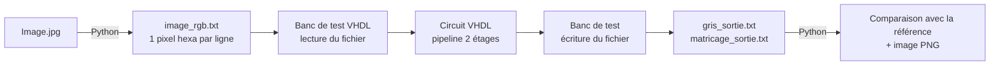

# Conversion d'image RGB → YCbCr et niveaux de gris en VHDL

Traitement d'image sur FPGA : un circuit VHDL convertit chaque pixel **RGB** en **niveaux de gris** puis en **YCbCr** (le « matriçage » utilisé en vidéo et en JPEG). Le circuit est simulé sous **ModelSim** et vérifié pixel par pixel avec **Python**.

| Image d'origine | Niveaux de gris (sortie VHDL) | Référence Python |
|:---:|:---:|:---:|
|  |  |  |

---

## Principe

Chaque composante est une combinaison linéaire de R, G et B. Pour éviter les nombres à virgule (coûteux sur FPGA), les coefficients sont multipliés par 256, puis le résultat est divisé par 256 en ne gardant que les bits 15..8 : **une division gratuite, sans aucune logique**.

```
Y  = ( 77·R + 150·G +  29·B) / 256
Cb = (-43·R -  85·G + 128·B) / 256 + 128
Cr = (128·R - 107·G -  21·B) / 256 + 128
```

Ces coefficients correspondent à la norme ITU-R BT.601 pleine échelle (celle du JPEG). L'offset de +128 sur Cb et Cr est ajouté avant la division (+32768), ce qui permet de garder tous les calculs en arithmétique non signée.

Le circuit est un **pipeline à 2 étages** qui traite **1 pixel par cycle d'horloge** :
1. **Étage 1** : 9 multiplications en parallèle (3 par composante)
2. **Étage 2** : sommes, offset, puis extraction des bits 15..8

## Chaîne de traitement



## Fichiers

| Fichier | Rôle |
|---|---|
| `conversion_Img.vhd` | Circuit VHDL (entité `matricage`) et son banc de test (`tb_matricage`) |
| `Projet_ConversionImg.py` | Prépare l'image : redimensionnement et export en `image_rgb.txt` |
| `verifier_gris.py` | Compare la sortie VHDL en niveaux de gris à la référence Python |
| `verifier_matricage.py` | Vérifie la sortie YCbCr du circuit |
| `image_rgb.txt` | Stimuli : un pixel RGB en hexadécimal par ligne |
| `gris_sortie.txt`, `matricage_sortie.txt` | Sorties de la simulation ModelSim |
| `reference_gris.txt`, `reference_gris.png` | Résultat de référence calculé en Python |
| `sortie_gris.png` | Image reconstruite à partir de la sortie VHDL |
| `Architecture_complete_matricage_*.pdf` | Schéma de l'architecture |

## Utilisation

### 1. Préparer l'image
```bash
python Projet_ConversionImg.py
```

### 2. Simuler sous ModelSim
```tcl
vlib work
vcom conversion_Img.vhd
vsim tb_matricage
run -all
```
La console affiche le nombre de pixels lus et écrits, et la sortie est écrite dans `matricage_sortie.txt`.

### 3. Vérifier
```bash
python verifier_gris.py
python verifier_matricage.py
```

## Prochaines étapes

- Porter le projet sur **Xilinx Vivado** et synthétiser pour une carte FPGA
- Ajouter une interface **AXI4-Stream** pour l'intégrer dans une chaîne vidéo Xilinx
- Arrondir au plus proche au lieu de tronquer (erreur ≤ 0,5 LSB)
- Tester sur carte : caméra → matriçage → sortie VGA/HDMI

## Outils

VHDL · ModelSim · Python (NumPy, Pillow)